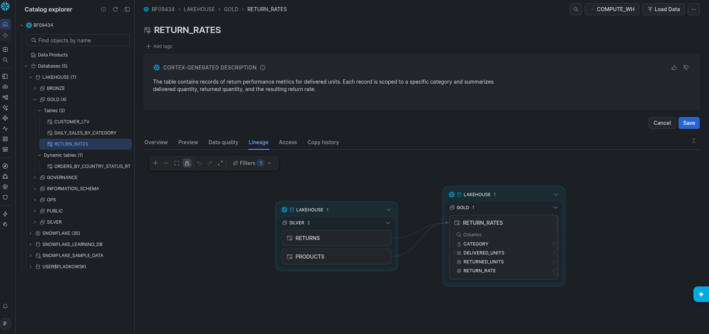
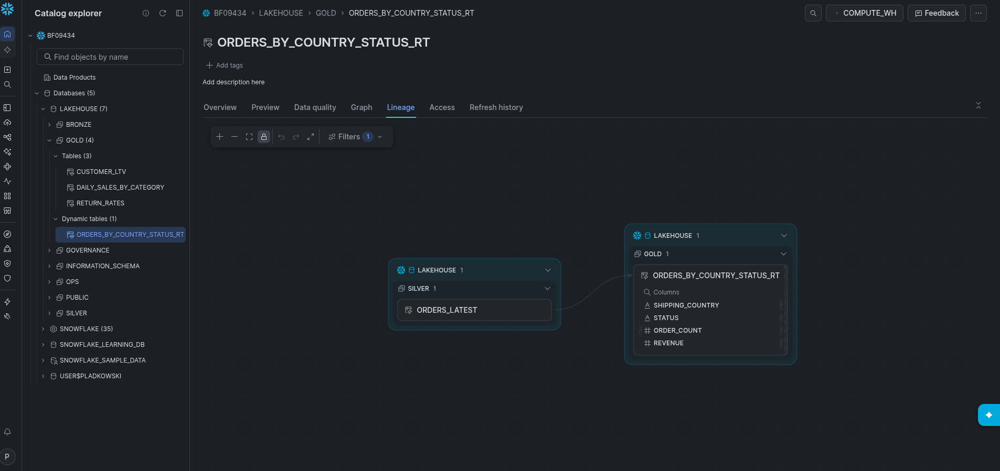
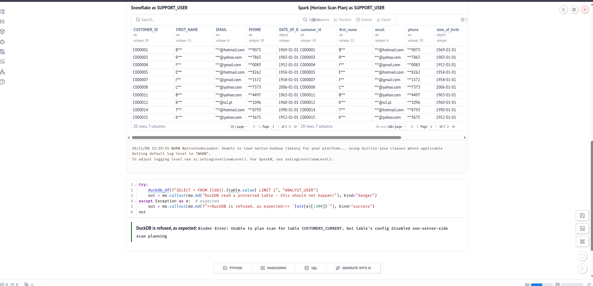
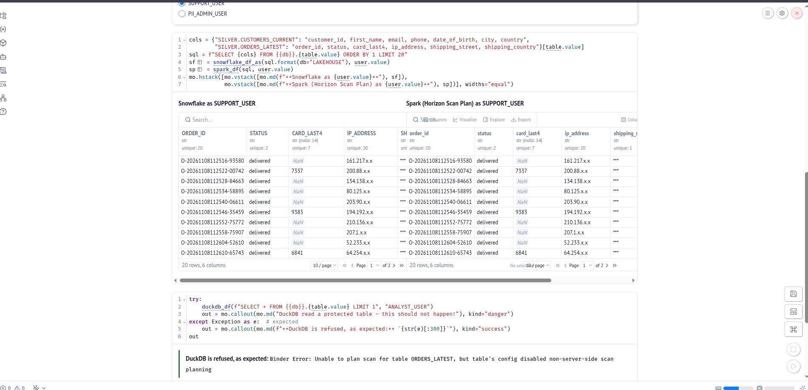

<!--
SZKIELET RAPORTU – do usunięcia przed eksportem do PDF.
- Piszemy własnymi słowami, po polsku (o ile prowadzący nie każe inaczej – pytanie na General z 8.11).
- Limit: 2–4 strony. Najwyżej 4–5 zrzutów, tabele krótkie.
- Dane i pomiary bierzemy z wersji roboczej: docs/run2(03b)/03b-lineage.md (dalej: v2). Nie kopiujemy z niej zdań.
- Wymagania: README repo prowadzącego, §9 „Task 1: lineage report”.
- Punkty w nawiasach kwadratowych […] to podpowiedzi, co ma się znaleźć w sekcji. Usuwamy je, gdy sekcja jest napisana.
-->

# Raport lineage – od generatora do warstwy gold

Zespół 03 (środowisko `03b`) · [imiona i nazwiska] · semestr 2026z · [data pomiarów: 2026-11-08, czasy w UTC]

## Zakres

[2–3 zdania: co śledzimy na każdej ścieżce i dlaczego na ścieżce wsadowej są dwa rekordy (klient do silver – kolumna `email`; zwrot do gold – `GOLD.RETURN_RATES`). Ostateczne brzmienie po odpowiedzi prowadzącego na kanale zespołu (pytanie o `CUSTOMER_LTV`, P25). Dane: v2, sekcja 0.]

## 1. Ścieżka wsadowa

### 1a. Zmiana klienta → silver

[Rekord: klient i plik, z którego przyszedł (v2, 1a).]

| Krok | Obiekt | Co przenosi dane | Narzędzie · plik | Czas | Format · silniki |
|---|---|---|---|---|---|
| 1 | | | | | |

[Jedno–dwa zdania: ile trwało od pliku do silver dla naszego rekordu i jaki jest najgorszy przypadek (harmonogram dbt).]

### 1b. Zwrot → gold

[Rekord: zwrot i plik (v2, 1b). Tabela tylko z krokami, które różnią się od 1a.]

| Krok | Obiekt | Co przenosi dane | Narzędzie · plik | Czas | Format · silniki |
|---|---|---|---|---|---|
| 1 | | | | | |

[„Przed i po” w `GOLD.RETURN_RATES` – jedno zdanie albo mała tabela; uwaga, że w tym samym przebiegu doszły też inne zwroty.]

## 2. Ścieżka strumieniowa

[Rekord: zamówienie z 4 zdarzeniami (v2, sekcja 2).]

| Krok | Obiekt | Co przenosi dane | Narzędzie · plik | Czas | Format · silniki |
|---|---|---|---|---|---|
| 1 | | | | | |

[Świeżość od publikacji do gold: do bronze sekundy, do gold średnio ~95 s, maks. ~195 s; dlaczego nie 2 × 5 min.]

## 3. Grafy lineage

[Po jednym grafie na ścieżkę. Zrzut z Snowsight pokazuje tylko obiekty Snowflake – kroki poza nim (GCS, Pub/Sub, bridge) dodajemy z kodu. Diagramy: Mermaid z v2 (sekcja 3) albo przerysowane.]

[Jedno zdanie: `GET_LINEAGE` i Snowsight nie pokazują `BRONZE.ORDERS_EVENTS` jako wejścia `RETURN_RATES`, choć kod go czyta.]

## 4. Kolumny PII: `email` i `ip_address`

[Tag `PII_TYPE`: gdzie ustawiony ręcznie (MANUAL), gdzie przeniesiony automatycznie (PROPAGATED) – tabela z v2, sekcja 4, skrócona do 4–5 wierszy.]

| Tabela.kolumna | `PII_TYPE` | `apply_method` | Kto ustawia |
|---|---|---|---|
| | | | |

[Gdzie działa maskowanie: przy zapytaniu, według roli, przez polityki podpięte do tagu; dane w plikach nie są maskowane; Spark dostaje to samo przez Horizon, DuckDB odmowa.]

## 5. Porównanie ścieżek

| | Wsad | Strumień |
|---|---|---|
| Opóźnienie | | |
| Koszt | | |
| Gdzie usuwane są duplikaty | | |

[Koszty: po ponownym `mise run cost` (Piotrek, ok. 15:30 8.11) – liczby z `docs/run2(03b)/cost.txt`; zaznaczyć, że suma obejmuje oba środowiska (03 i 03b).]

## Wnioski

[2–3 zdania własne: co z tego wynika – np. kiedy wybrać wsad, a kiedy strumień.]
