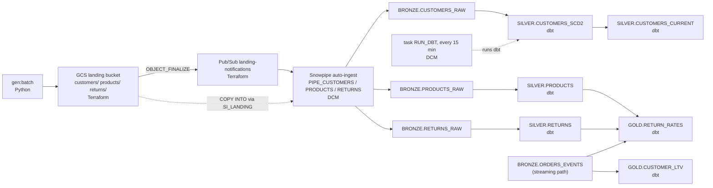

# Lineage report: from generator to gold (team 03)

> **DRAFT.** Everything not marked was read from the code or measured in our Snowflake account on
> 2026-11-07 (all times UTC). Search for `[CHECK` to find what you still have to verify, measure or
> fill in; each marker says how. Delete this box and all markers before exporting to `03-lineage.pdf`.

Team 03 · `[CHECK: names]` · semester 2026z · GCP project `tbd-2026z-stud03-data`, region `europe-west4`
· Snowflake database `LAKEHOUSE` (account `[CHECK: SNOWFLAKE_ACCOUNT from .env]`).

## 0. Read this first (scope note)

The task suggests following a customer change to `GOLD.CUSTOMER_LTV`. **In this repo no gold table is
built from customer data.** `GET_LINEAGE` on `CUSTOMER_LTV` shows a single upstream object,
`BRONZE.ORDERS_EVENTS` (the order stream), and `dbt/models/gold/customer_ltv.sql` only hashes the
`customer_id` found in the orders (`customer_key = sha2(customer_id || salt)`). So we follow:

- **a customer change** (batch) as far as it goes, `SILVER.CUSTOMERS_CURRENT`, because it carries the
  `email` column the task asks about, and
- **a return** (batch) all the way to gold, `GOLD.RETURN_RATES`, to show a batch file that reaches gold.

`[CHECK: this is our reading of the task. If you want to be sure, ask the teacher whether following
the customer to silver + a return to gold is acceptable. Keep or drop this section accordingly.]`

**Common to every step.** All 15 BRONZE/SILVER/GOLD tables are Snowflake-managed **Iceberg** tables
(`SHOW TABLES`: `is_iceberg = Y`), stored as Parquet + metadata in
`gs://tbd-2026z-stud03-data-lakehouse/iceberg/…` through the external volume `EV_LAKEHOUSE`
(`snowflake/integrations.tf`). Engine access, from `docs/lessons.md` §1 and `lab/notebooks/`:
**SF** = Snowflake reads all of them; **SP** = Spark reads all of them through Horizon's Iceberg REST
catalog, which plans the scan server-side and applies masking and row access per user; **DD** =
DuckDB cannot do server-side planning, so Horizon refuses it every table with a policy and it reads only
the PII-free gold tables.

## 1. Batch path

Followed record: customer `C001775`, its 3rd version (`NL`, changed at 13:11:08), file
`customers/customers-20261107T131108-5.json`. `[CHECK: optional, pick a newer change with
SELECT customer_id, COUNT(*) FROM LAKEHOUSE.SILVER.CUSTOMERS_SCD2 GROUP BY 1 HAVING COUNT(*) > 1]`

### 1a. Customer change → silver

| # | Object | What moves the data in | Tool · file | Timing | Format · engines |
|---|---|---|---|---|---|
| 1 | `mise run gen:batch` | Python loop writes NDJSON; first drop = 2000 customers + 200 products, then 20 customer changes (3–7 new), 5 product changes, ≤10 returns | Python · `src/tbd_lakehouse/generators/batch.py` | new drop every **180–300 s** (random) | NDJSON |
| 2 | GCS bucket `tbd-2026z-stud03-data-landing`, `customers/customers-<UTC stamp>-<n>.json` | `GcsStorage.upload` (`generators/_io.py`) | Terraform · `gcp/storage.tf` | immediate | NDJSON, not Iceberg, no engine |
| 3 | Pub/Sub topic `landing-notifications` | GCS sends an `OBJECT_FINALIZE` event per file (the GCS service agent has `pubsub.publisher` on the topic) | Terraform · `gcp/storage.tf`, `gcp/pubsub.tf` | `[CHECK: seconds; not measured]` | — |
| 4 | Subscription `landing-notifications-snowpipe` → notification integration `NI_LANDING` | Snowflake reads the queue | Terraform · `gcp/pubsub.tf`, `snowflake/integrations.tf` | — | — |
| 5 | Pipe `BRONZE.PIPE_CUSTOMERS` (stage `LANDING_STAGE`, storage integration `SI_LANDING`) | Snowpipe **auto-ingest**: `COPY INTO BRONZE.CUSTOMERS_RAW` for each notified file | DCM · `dcm/sources/definitions/ingest.sql` | measured **2–117 s** from file drop to scan start (4 files: 15 s, 117 s, 2 s, 18 s; ours: 18 s). Serverless | — |
| 6 | `BRONZE.CUSTOMERS_RAW` | rows appended by the pipe, plus `_file` and `_ingested_at` (= `METADATA$START_SCAN_TIME`) | Terraform · `snowflake/bronze.tf` | — | Iceberg · SF, SP (masked); DD refused (tagged PII) |
| 7 | Task `OPS.RUN_DBT` | `EXECUTE DBT PROJECT LAKEHOUSE.OPS.LAKEHOUSE_DBT ARGS='build --exclude test_type:unit'` on `WH_TRANSFORM` | DCM · `dcm/sources/definitions/dbt_task.sql`; project uploaded by `mise run dbt:deploy` | **every 15 min**; a run took 22–24 s (2 runs) | — |
| 8 | `SILVER.CUSTOMERS_SCD2` | dbt table: one row per `(customer_id, updated_at)`, with `valid_from`, `valid_to`, `is_current` | dbt · `dbt/models/silver/customers_scd2.sql` | within the 15-min run | Iceberg · SF, SP; DD refused |
| 9 | `SILVER.CUSTOMERS_CURRENT` | `WHERE is_current`; row access policy attached by a post-hook | dbt · `customers_current.sql`, macro `attach_row_access.sql` | same run | Iceberg · SF, SP; DD refused (checked by `tests/live/test_engines.py`) |

**Measured for our record:** dropped 13:11:08 → Snowpipe scan 13:11:26 → dbt run 13:13:35–13:13:58 →
visible in `CUSTOMERS_SCD2` ≈ **2 min 50 s** (lucky timing; worst case ≈ 2 min + 15 min + 25 s).
`[CHECK: also confirm in CUSTOMERS_CURRENT: SELECT * FROM LAKEHOUSE.SILVER.CUSTOMERS_CURRENT WHERE customer_id = 'C001775']`

### 1b. Return → gold

Same steps 1–6 with `returns/returns-….json` → `PIPE_RETURNS` → `BRONZE.RETURNS_RAW`, then the same
`RUN_DBT` task builds `SILVER.RETURNS` (`returns.sql`, dedup by `return_id`) and
`GOLD.RETURN_RATES` (`return_rates.sql`, joins `SILVER.RETURNS`, `SILVER.PRODUCTS` and the order
lines). Gold is Iceberg, has no PII columns, and is readable by SF, SP **and DD**.
Note the returns are generated from orders the *stream* generator delivered
(`.state/generators/…/recent_orders.txt`), so the batch gold tables also read `ORDERS_EVENTS`.
`[CHECK: pick one return: SELECT * FROM LAKEHOUSE.BRONZE.RETURNS_RAW ORDER BY _ingested_at DESC LIMIT 1, then find it in SILVER.RETURNS]`

## 2. Streaming path

Followed record: order `O-20261107131008-57603` (placed 13:10:08 → … → delivered 13:15:19, 4 events).
`[CHECK: any order works: SELECT order_id, COUNT(*) FROM LAKEHOUSE.BRONZE.ORDERS_EVENTS GROUP BY 1 HAVING COUNT(*) >= 4 ORDER BY 1 DESC LIMIT 3]`

| # | Object | What moves the data in | Tool · file | Timing | Format · engines |
|---|---|---|---|---|---|
| 1 | `mise run gen:stream` | Python publishes JSON events; an order every 12th tick; lifecycle placed → paid (+5–30 s) → shipped (+60–180 s) → delivered (+120–360 s), or 10 % placed → cancelled | Python · `generators/stream.py`, `model.py` | default **2 events/s** | JSON |
| 2 | Pub/Sub topic `orders-events` | `PubSubPublisher.publish` | Terraform · `gcp/pubsub.tf` | ms | — |
| 3 | Subscription `orders-events-bridge` | ack deadline 60 s, 7-day retention | Terraform · `gcp/pubsub.tf` | — | — |
| 4 | **Bridge** (`mise run bridge`, runs on the laptop) | pulls ≤500 messages, appends them to the Snowpipe Streaming channel `bridge-orders_events` as `INGEST_SVC`/`INGEST`; **acks only after Snowflake commits** (at-least-once); sets `_ingested_at` = Pub/Sub publish time | Python · `bridge/main.py`, `bridge/mapping.py` | polls every 0.5 s | — |
| 5 | Pipe `BRONZE.PIPE_ORDERS_STREAM` | Snowpipe Streaming (`DATA_SOURCE(TYPE => 'STREAMING')`) | DCM · `dcm/sources/definitions/streaming_pipes.sql` | publish → visible in bronze **≈ 3–9 s** (4 samples of `now − MAX(_ingested_at)` on the clickstream table: 2.9, 5.6, 9.3, 9.0 s) `[CHECK: measure on orders: publish a test order and poll, as tests/live/test_streaming_ingest.py does; the orders feed had paused when we sampled]` | — |
| 6 | `BRONZE.ORDERS_EVENTS` | append-only | Terraform · `snowflake/bronze.tf` | — | Iceberg · SF, SP (masked); DD refused |
| 7 | `SILVER.ORDERS_LATEST` | **dynamic Iceberg table**: dedup by `event_id`, then latest status per order by `event_ts` | Terraform (`snowflake_execute`) · `snowflake/dynamic_tables.tf` (DCM can't define dynamic Iceberg tables yet) | **TARGET_LAG 5 min** (`var.dt_target_lag`), `WH_TRANSFORM`, refresh mode FULL, a refresh takes 1–2 s | Iceberg · SF, SP; DD refused |
| 8 | `GOLD.ORDERS_BY_COUNTRY_STATUS_RT` | dynamic Iceberg table: `COUNT`, `SUM` per country and status | Terraform · `snowflake/dynamic_tables.tf` | TARGET_LAG 5 min, FULL | Iceberg · SF, SP, **DD** (no PII) |

Freshness end to end: seconds to bronze + up to 5 min per dynamic-table layer.
`[CHECK: Snowflake keeps chained dynamic tables aligned, so gold should be at most ~5 min behind bronze, not 10. Verify with SHOW DYNAMIC TABLES IN DATABASE LAKEHOUSE (columns data_timestamp, target_lag) or Snowsight → the table → Refresh history.]`

## 3. Lineage graphs

Paste a Snowsight screenshot (**Catalog → Database Explorer → LAKEHOUSE → GOLD → table → Lineage**) or
render the diagrams below (mermaid.live, or a Markdown preview with Mermaid).
`[SCREENSHOT: Lineage tab of GOLD.RETURN_RATES]` `[SCREENSHOT: Lineage tab of GOLD.ORDERS_BY_COUNTRY_STATUS_RT]`

Snowflake's own lineage (`SNOWFLAKE.CORE.GET_LINEAGE(..., 'UPSTREAM', 5)`):

| Table | Upstream, direct → further |
|---|---|
| `GOLD.CUSTOMER_LTV` | `BRONZE.ORDERS_EVENTS` |
| `GOLD.DAILY_SALES_BY_CATEGORY` | `BRONZE.ORDERS_EVENTS`, `SILVER.PRODUCTS` ← `BRONZE.PRODUCTS_RAW` |
| `GOLD.RETURN_RATES` | `SILVER.PRODUCTS` ← `BRONZE.PRODUCTS_RAW`; `SILVER.RETURNS` ← `BRONZE.RETURNS_RAW` |
| `GOLD.ORDERS_BY_COUNTRY_STATUS_RT` | `SILVER.ORDERS_LATEST` (dynamic table) ← `BRONZE.ORDERS_EVENTS` |
| `SILVER.CUSTOMERS_CURRENT` | `SILVER.CUSTOMERS_SCD2` ← `BRONZE.CUSTOMERS_RAW` |

`[CHECK: GET_LINEAGE for RETURN_RATES does not list BRONZE.ORDERS_EVENTS, although return_rates.sql reads it through the latest_orders() macro. Look at the Snowsight Lineage tab; if it also lacks it, say "lineage is built from query history and can miss inputs" in one sentence.]`

**Batch path**

**Streaming path**

```mermaid
flowchart LR
  GS["gen:stream<br/>Python"] --> TO["Pub/Sub topic orders-events<br/>Terraform"]
  TO --> SO["subscription orders-events-bridge"]
  SO --> BR["bridge<br/>Python, on the laptop"]
  BR -- "Snowpipe Streaming channel" --> PS["PIPE_ORDERS_STREAM<br/>DCM"]
  PS --> OE["BRONZE.ORDERS_EVENTS<br/>Terraform"]
  OE -- "dynamic table, lag 5 min" --> OL["SILVER.ORDERS_LATEST<br/>Terraform"]
  OL -- "dynamic table, lag 5 min" --> RT["GOLD.ORDERS_BY_COUNTRY_STATUS_RT<br/>Terraform"]
```

## 4. Following one PII column

The tag is `LAKEHOUSE.GOVERNANCE.PII_TYPE` (values `NAME EMAIL PHONE ADDRESS DOB IP CARD`), created
with `PROPAGATE = ON_DEPENDENCY_AND_DATA_MOVEMENT` (`snowflake/governance.tf`). Two masking policies
are bound to the **tag**, not to columns: `MP_PII_STRING` and `MP_PII_DATE`. Check yourself with
`SELECT * FROM TABLE(LAKEHOUSE.INFORMATION_SCHEMA.TAG_REFERENCES_ALL_COLUMNS('LAKEHOUSE.SILVER.ORDERS_LATEST','TABLE'))`.

### `email` (batch)

| Table.column | `PII_TYPE` | `apply_method` | Set by |
|---|---|---|---|
| `BRONZE.CUSTOMERS_RAW.EMAIL` | `EMAIL` | **MANUAL** | Terraform `snowflake_tag_association.pii`, driven by the column list in `snowflake/bronze.tf` |
| `SILVER.CUSTOMERS_SCD2.EMAIL` | `EMAIL` | **MANUAL** | dbt post-hook `apply_pii_tags()` (`dbt/macros/apply_pii_tags.sql`) turns `meta: {pii_type: EMAIL}` in `dbt/models/silver/_silver.yml` into `ALTER ICEBERG TABLE … SET TAG` after every build |
| `SILVER.CUSTOMERS_CURRENT.EMAIL` | `EMAIL` | **MANUAL** | same post-hook |
| gold | — | — | no `email` column: `CUSTOMER_LTV` only has `customer_key = sha2(customer_id || salt)` |

`[CHECK: the tag could also propagate, yet dbt tables show MANUAL. Our explanation: the post-hook sets
it explicitly after every build (docs/lessons.md §3 says "MANUAL for tags from dbt"). Confirm by
running the TAG_REFERENCES_ALL_COLUMNS query on SILVER.CUSTOMERS_SCD2 yourself.]`

### `ip_address` (streaming)

| Table.column | `PII_TYPE` | `apply_method` | Set by |
|---|---|---|---|
| `BRONZE.ORDERS_EVENTS.IP_ADDRESS` | `IP` | **MANUAL** | Terraform `snowflake_tag_association.pii` (`snowflake/bronze.tf`) |
| `SILVER.ORDERS_LATEST.IP_ADDRESS` | `IP` | **PROPAGATED** | Snowflake lineage propagation; no code in `dynamic_tables.tf` sets it |
| `GOLD.ORDERS_BY_COUNTRY_STATUS_RT` | — | — | no IP column (only country, status, count, revenue) |

### Where masking is applied

- **At query time, by role**, from the tag-bound policies: `snowflake/governance.tf`, bodies in
  `snowflake/sql/mp_pii_string.sql` and `mp_pii_date.sql`. Only `CURRENT_ROLE()` counts (secondary
  roles never unmask). Stored data is **not** masked: the dynamic table is refreshed by
  `PIPELINE_ADMIN`, which is exempt, so it stores real values (`docs/lessons.md` §4).
- **Row access** on `SILVER.CUSTOMERS_CURRENT`: `RAP_SUPPORT_COUNTRY`; `SUPPORT_USER` sees only PL, NL.
- **Spark** gets the same result through Horizon scan planning; **DuckDB** is refused.
- **Not masked:** the Parquet files in the GCS bucket (anyone with bucket access sees everything).

What each role sees (queried in Snowflake with `--role`, synthetic data):

| Role | `EMAIL` (bronze/silver) | `IP_ADDRESS` (`SILVER.ORDERS_LATEST`) |
|---|---|---|
| `PII_ADMIN` | `ida.materek97@onet.pl` | `212.11.74.51` |
| `SUPPORT` | `***@onet.pl` | `212.11.x.x` |
| `ANALYST` | `***` | `***` |

`[SCREENSHOT: lab/notebooks/02_masking, Snowflake and Spark side by side, for ANALYST_USER on SILVER.CUSTOMERS_CURRENT and on SILVER.ORDERS_LATEST]`

## 5. Comparing the paths

| | Batch | Streaming |
|---|---|---|
| **Latency** | file → bronze: 2–117 s (Snowpipe). Silver/gold: wait for the next dbt run, **every 15 min** (22–24 s run). Typical worst case ≈ 17–18 min from file drop. Measured example: 2 min 50 s (lucky timing). | publish → bronze ≈ 3–9 s. Each dynamic table: target lag **5 min**. End to end ≈ seconds + up to 5 min. `[CHECK: measure end to end for one order]` |
| **Cost drivers** | Snowpipe (serverless, per file) + `WH_TRANSFORM` X-Small for ~24 s per run; with 60 s auto-suspend a run is billed ≈ 1.4 min, ≈ 0.02 credits, so about 4 runs/h ≈ 0.1 credits/h `[CHECK: estimate, not measured]` | Snowpipe Streaming (serverless) + dynamic-table refreshes on `WH_TRANSFORM` every few minutes, so the warehouse is awake much of the time; `var.dt_target_lag` says 1 min ≈ 24 credits/day, 5 min "cheap". Orders and gold are FULL refreshes (recomputed each time). Also the bridge process on the laptop and Pub/Sub. |
| **Where duplicates are removed** | In **dbt, silver**: `customers_scd2` keeps one row per `(customer_id, updated_at)` (latest `_ingested_at`); `products` by `product_id`; `returns` by `return_id`; the gold macro `latest_orders()` dedups orders by `event_id` again. Snowpipe also does not reload a file it already loaded (load history). Bronze keeps whatever arrived. | **Not in bronze** (append-only). The bridge is at-least-once: a crash or Ctrl-C re-delivers un-acked messages. Removed in the **dynamic tables**: `SILVER.ORDERS_LATEST` and `SILVER.CLICKSTREAM` by `event_id`; then the latest status per order by `event_ts` (not arrival order). |
| **Duplicates seen** | none: 2100 rows = 2100 distinct `(customer_id, updated_at)` in `CUSTOMERS_RAW` | none: 935 rows = 935 distinct `event_id` in `ORDERS_EVENTS` (both at the time of measuring) |

**Cost measured so far.** `WH_TRANSFORM` used 0.293 credits in the last 12 h, **shared by both paths**
(the dbt task and the dynamic tables run on it). Snowpipe: ≈ 0.000002 credits for 17 files.
`mise run cost` (account-wide, 31 days): 0.50 of 12 credits (4 %, ≈ $1.94 at $3.90/credit); the serverless
rows (`PIPE`, `SNOWPIPE_STREAMING`) still show 0.000 because `ACCOUNT_USAGE` lags up to ~3 h.
`[CHECK: re-run mise run cost in 3+ hours and fill in credits per service. To split the shared warehouse, compare the number of TASK_HISTORY runs with DYNAMIC_TABLE_REFRESH_HISTORY refreshes.]`

## 6. Open items before you export

| What | How |
|---|---|
| Names, account id, team number | `.env` (`TF_VAR_team_id`, `SNOWFLAKE_ACCOUNT`) |
| Confirm the `CUSTOMER_LTV` interpretation (section 0) | teacher / task text |
| Snowsight lineage screenshots (section 3) | Catalog → Database Explorer |
| Streaming latency for **orders** (section 2, step 5) | publish one order, poll `BRONZE.ORDERS_EVENTS` |
| Dynamic-table staleness vs bronze (section 2) | `SHOW DYNAMIC TABLES IN DATABASE LAKEHOUSE` |
| Why dbt tags are MANUAL (section 4) | `TAG_REFERENCES_ALL_COLUMNS` on `SILVER.CUSTOMERS_SCD2` |
| Masking screenshot incl. Spark (section 4) | marimo `02_masking` |
| Cost per service (section 5) | `mise run cost` after 3+ hours |
| Page count 2–4 | delete this section and the draft box, shorten section 0 and the tables |
