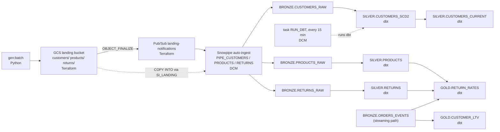

# Lineage report: from generator to gold (team 03, environment `03b`)

> **DRAFT.** Unmarked text was read from the code or measured in environment `03b` on 2026-11-08
> (about 03:20–04:10 Pacific, 11:20–12:10 UTC; **all times below are UTC**). Search for `[CHECK` (to
> verify or fill in yourself) and `[SCREENSHOT` (pictures to add). Delete this box and every marker
> before exporting the PDF (file name: ask the teacher, `03` or `03b`).

Team 03 (environment `03b`) · `[CHECK: names]` · semester 2026z · GCP project `tbd-2026z-stud03b-data`,
region `europe-west4` · Snowflake database `LAKEHOUSE` (account `AWLVJAV-BF09434`).

## 0. Scope note

The task suggests following a customer change to `GOLD.CUSTOMER_LTV`. **In this repo no gold table is
built from customer data.** `GET_LINEAGE` on `CUSTOMER_LTV` shows a single upstream object,
`BRONZE.ORDERS_EVENTS` (the order stream), and `dbt/models/gold/customer_ltv.sql` only hashes the
`customer_id` found in the orders (`customer_key = sha2(customer_id || salt)`). So the batch path has two
examples, both started by `mise run gen:batch`:

- **a customer change**, as far as it goes (`SILVER.CUSTOMERS_CURRENT`), because it carries the `email`
  column the task asks about (section 1a), and
- **a return**, all the way to gold (`GOLD.RETURN_RATES`), as the batch file that reaches gold (section 1b).

`[CHECK: this is our reading of the task ("for example GOLD.CUSTOMER_LTV"). Ask the teacher whether it is acceptable; keep or shorten this section accordingly.]`

**Common to every step.** All 15 BRONZE/SILVER/GOLD tables are Snowflake-managed **Iceberg** tables
(`SHOW TABLES`: `is_iceberg = Y`), stored as Parquet + metadata in
`gs://tbd-2026z-stud03b-data-lakehouse/iceberg/…` through the external volume `EV_LAKEHOUSE`
(`snowflake/integrations.tf`). Engine access, from `docs/lessons.md` §1 and `lab/notebooks/`:
**SF** = Snowflake reads all of them; **SP** = Spark reads all of them through Horizon's Iceberg REST
catalog, which plans the scan server-side and applies masking and row access per user; **DD** =
DuckDB cannot do server-side planning, so Horizon refuses it every table with a policy and it reads only
the PII-free gold tables. The lab checks passed on `03b` (parity 3/3, masking 5/5, tag propagation 3/3).

## 1. Batch path

### 1a. Customer change → silver (for the PII column)

Record: customer `C001796`, second version (`NL`, changed at 11:46:08), file
`customers/customers-20261108T114608-5.json`. Its first version came in the first drop
(`customers-20261108T112506-0.json`).

| # | Object | What moves the data in | Tool · file | Timing | Format · engines |
|---|---|---|---|---|---|
| 1 | `mise run gen:batch` | Python loop writes NDJSON; first drop = 2000 customers + 200 products, then 20 customer changes (3–7 new), 5 product changes, ≤10 returns | Python · `src/tbd_lakehouse/generators/batch.py` | new drop every **180–300 s** (random) | NDJSON |
| 2 | GCS bucket `tbd-2026z-stud03b-data-landing`, `customers/customers-<UTC stamp>-<n>.json` | `GcsStorage.upload` (`generators/_io.py`) | Terraform · `gcp/storage.tf` | immediate | NDJSON, not Iceberg, no engine |
| 3 | Pub/Sub topic `landing-notifications` | GCS sends an `OBJECT_FINALIZE` event per file (the GCS service agent has `pubsub.publisher` on the topic) | Terraform · `gcp/storage.tf`, `gcp/pubsub.tf` | `[CHECK: seconds; not measured separately, it is inside row 5]` | — |
| 4 | Subscription `landing-notifications-snowpipe` → notification integration `NI_LANDING` | Snowflake reads the queue | Terraform · `gcp/pubsub.tf`, `snowflake/integrations.tf` | — | — |
| 5 | Pipe `BRONZE.PIPE_CUSTOMERS` (stage `LANDING_STAGE`, storage integration `SI_LANDING`) | Snowpipe **auto-ingest**: `COPY INTO BRONZE.CUSTOMERS_RAW` for each notified file | DCM · `dcm/sources/definitions/ingest.sql` | file drop → scan start: **22 s** for our file. Over all 22 files (8 customers, 8 products, 6 returns): **1–285 s**, medians 44–63 s; the slowest are the first drops. Serverless | — |
| 6 | `BRONZE.CUSTOMERS_RAW` | rows appended by the pipe, plus `_file` and `_ingested_at` (= `METADATA$START_SCAN_TIME`) | Terraform · `snowflake/bronze.tf` | — | Iceberg · SF, SP (masked); DD refused (tagged PII) |
| 7 | Task `OPS.RUN_DBT` | `EXECUTE DBT PROJECT LAKEHOUSE.OPS.LAKEHOUSE_DBT ARGS='build --exclude test_type:unit'` on `WH_TRANSFORM` | DCM · `dcm/sources/definitions/dbt_task.sql`; project uploaded by `mise run dbt:deploy` | **every 15 min**; runs took **22–29 s** (3 runs) | — |
| 8 | `SILVER.CUSTOMERS_SCD2` | dbt table: one row per `(customer_id, updated_at)`, with `valid_from`, `valid_to`, `is_current` | dbt · `dbt/models/silver/customers_scd2.sql` | within the 15-min run | Iceberg · SF, SP; DD refused |
| 9 | `SILVER.CUSTOMERS_CURRENT` | `WHERE is_current`; row access policy attached by a post-hook | dbt · `customers_current.sql`, macro `attach_row_access.sql` | same run | Iceberg · SF, SP; DD refused (checked by `tests/live/test_engines.py`) |

**What happened to `C001796`:** the file was written at 11:46:08, Snowpipe started scanning it at 11:46:30,
the dbt run of 11:49:23–11:49:46 built `SILVER.CUSTOMERS_SCD2` and `CUSTOMERS_CURRENT`: the change was
visible after **≈ 3 min 37 s**. In `CUSTOMERS_SCD2` the first version now has
`valid_to = 11:46:08.225` and `is_current = false`; the second has `valid_from = 11:46:08.225` and
`is_current = true`. Worst case is the Snowpipe delay + up to 15 min + a 22–29 s run, so ≈ 18–20 min.
(The first run on the list was started by the test suite, so the spacing between runs is not the schedule.)

### 1b. Return → gold

Record: return `ddc8bd78-ffde-4c62-ba6d-5bb4625d1c80` (1 unit of product `P0050`, category `beauty`,
reason "not as described", order `O-20261108114228-85273`), written by `gen:batch` at 11:54:13 in
`returns/returns-20261108T115413-7.json`.

| # | Object | What moves the data in | Tool · file | Timing | Format · engines |
|---|---|---|---|---|---|
| 1 | `mise run gen:batch` | `make_return` picks recently **delivered** order lines (the stream generator writes them to `.state/generators/…/recent_orders.txt`), ≤10 per drop | Python · `generators/batch.py`, `model.py` | every 180–300 s | NDJSON |
| 2 | GCS `returns/returns-20261108T115413-7.json`, then rows 3–4 of 1a (notification → `NI_LANDING`) | upload + `OBJECT_FINALIZE` | Terraform · `gcp/` | — | NDJSON |
| 3 | Pipe `BRONZE.PIPE_RETURNS` → `BRONZE.RETURNS_RAW` | Snowpipe auto-ingest (`COPY INTO`) | DCM · `ingest.sql`; table: Terraform · `snowflake/bronze.tf` | scan started 11:54:14.96, **≈ 2 s** after the drop (returns files: 1–146 s, median 44 s) | Iceberg · SF, SP; DD `[CHECK: not tested]` |
| 4 | `SILVER.RETURNS` | dbt table, one row per `return_id` | dbt · `dbt/models/silver/returns.sql` | next dbt run | Iceberg · SF, SP, DD `[CHECK: not tested]` |
| 5 | `GOLD.RETURN_RATES` | dbt table: returned vs delivered units per category (joins `SILVER.RETURNS`, `SILVER.PRODUCTS` and the order lines) | dbt · `dbt/models/gold/return_rates.sql` | same run | Iceberg · SF, SP, **DD** (no PII; tags: none) |

**Before and after.** At 11:55:22 the return was in `BRONZE.RETURNS_RAW` but not yet in `SILVER.RETURNS`
(it was waiting for the next dbt run). We read `GOLD.RETURN_RATES` then and again after the run:

| `GOLD.RETURN_RATES`, category `beauty` | delivered units | returned units | return rate |
|---|---|---|---|
| before (11:55:22, return only in bronze) | 57 | 7 | 0.1228 |
| after (dbt run 12:06:01–12:06:30, 29 s; read at 12:07:16) | 118 | 11 | 0.0932 |

Our return is in `SILVER.RETURNS` after the run, so it is part of the gold number. It is **not the only change**,
though: the run added 4 returned units to `beauty`, our 1 unit plus 3 units from
`returns-20261108T120049-9.json`, which was dropped at 12:00:49, after our "before" reading. Delivered
units doubled (57 → 118) because the stream kept delivering orders during those 11 minutes, so the
rate went down although returns went up. For our return: dropped 11:54:13 → Snowpipe scan 11:54:15 →
dbt run 12:06:01–12:06:30 → in gold, **≈ 12 min 17 s after the drop**, against 3 min 37 s for the customer
change in 1a. The difference is only where in the 15-minute cycle the file landed.

The returned order `O-20261108114228-85273` was itself produced by `gen:stream` (section 2), so the two
paths meet at gold: `RETURN_RATES` also reads `BRONZE.ORDERS_EVENTS` through the `latest_orders()` macro
(`dbt/macros/order_status.sql`) to count delivered units.

## 2. Streaming path

Record: order `O-20261108114228-85273` (`NL`, 566.77 EUR): placed 11:42:28, paid 11:42:55, shipped
11:43:56, delivered 11:46:52 (4 events). Its Pub/Sub publish time is 0.2–0.6 s after each `event_ts`
(`_ingested_at` in bronze is the Pub/Sub publish time). In `SILVER.ORDERS_LATEST` it has one row,
`status = delivered`.

| # | Object | What moves the data in | Tool · file | Timing | Format · engines |
|---|---|---|---|---|---|
| 1 | `mise run gen:stream` | Python publishes JSON events; an order every 12th tick; lifecycle placed → paid (+5–30 s) → shipped (+60–180 s) → delivered (+120–360 s), or 10 % placed → cancelled | Python · `generators/stream.py`, `model.py` | default **2 events/s**; publish ≈ 0.2–0.6 s after the event time | JSON |
| 2 | Pub/Sub topic `orders-events` | `PubSubPublisher.publish` | Terraform · `gcp/pubsub.tf` | ms | — |
| 3 | Subscription `orders-events-bridge` | ack deadline 60 s, 7-day retention | Terraform · `gcp/pubsub.tf` | — | — |
| 4 | **Bridge** (`mise run bridge`, runs on the laptop) | pulls ≤500 messages, appends them to the Snowpipe Streaming channel `bridge-orders_events` as `INGEST_SVC`/`INGEST`; **acks only after Snowflake commits** (at-least-once); sets `_ingested_at` = Pub/Sub publish time | Python · `bridge/main.py`, `bridge/mapping.py` | polls every 0.5 s | — |
| 5 | Pipe `BRONZE.PIPE_ORDERS_STREAM` | Snowpipe Streaming (`DATA_SOURCE(TYPE => 'STREAMING')`) | DCM · `dcm/sources/definitions/streaming_pipes.sql` | publish → visible in bronze: newest **click** event was **5–13 s** old (6 samples, median 7 s; the best proxy, since clicks arrive every ~0.5 s). Newest **order** event: 5–25 s (4 samples; bounded by the gaps between order events) | — |
| 6 | `BRONZE.ORDERS_EVENTS` | append-only | Terraform · `snowflake/bronze.tf` | — | Iceberg · SF, SP (masked); DD refused |
| 7 | `SILVER.ORDERS_LATEST` | **dynamic Iceberg table**: dedup by `event_id`, then latest status per order by `event_ts` | Terraform (`snowflake_execute`) · `snowflake/dynamic_tables.tf` (DCM can't define dynamic Iceberg tables yet) | **TARGET_LAG 5 min** (`var.dt_target_lag`), `WH_TRANSFORM`, refresh mode FULL, a refresh takes ≈ 1.3 s (18 refreshes). Measured lag: **mean 94 s, max 194 s**, 100 % of the time within target | Iceberg · SF, SP; DD refused |
| 8 | `GOLD.ORDERS_BY_COUNTRY_STATUS_RT` | dynamic Iceberg table: `COUNT`, `SUM` per country and status | Terraform · `snowflake/dynamic_tables.tf` | TARGET_LAG 5 min, FULL, ≈ 0.8 s per refresh (13). Measured lag: **mean 95 s, max 195 s** | Iceberg · SF, SP, **DD** (no PII) |

Freshness end to end: **≈ 5–13 s to bronze, then a mean of ~95 s and at most ~195 s to gold** (Snowflake's
`INFORMATION_SCHEMA.DYNAMIC_TABLES()` reports `MEAN_LAG_SEC` and `MAXIMUM_LAG_SEC` per dynamic table). The gold lag
is not the sum of two 5-minute lags: the chained tables refresh together.

## 3. Lineage graphs

Paste a Snowsight screenshot (**Catalog → Database Explorer → LAKEHOUSE → GOLD → table → Lineage**) or
render the diagrams below (mermaid.live, or a Markdown preview with Mermaid).
`[SCREENSHOT: Lineage tab of GOLD.RETURN_RATES]` `[SCREENSHOT: Lineage tab of GOLD.ORDERS_BY_COUNTRY_STATUS_RT]`

Snowflake's own lineage (`SNOWFLAKE.CORE.GET_LINEAGE('LAKEHOUSE.GOLD.<table>', 'TABLE', 'UPSTREAM', 5)`, run on `03b`):

| Table | Upstream, direct → further |
|---|---|
| `GOLD.CUSTOMER_LTV` | `BRONZE.ORDERS_EVENTS` |
| `GOLD.DAILY_SALES_BY_CATEGORY` | `BRONZE.ORDERS_EVENTS`, `SILVER.PRODUCTS` ← `BRONZE.PRODUCTS_RAW` |
| `GOLD.RETURN_RATES` | `SILVER.PRODUCTS` ← `BRONZE.PRODUCTS_RAW`; `SILVER.RETURNS` ← `BRONZE.RETURNS_RAW` |
| `GOLD.ORDERS_BY_COUNTRY_STATUS_RT` | `SILVER.ORDERS_LATEST` (dynamic table) ← `BRONZE.ORDERS_EVENTS` |
| `SILVER.CUSTOMERS_CURRENT` | `SILVER.CUSTOMERS_SCD2` ← `BRONZE.CUSTOMERS_RAW` |

Note: `GET_LINEAGE` for `RETURN_RATES` does not list `BRONZE.ORDERS_EVENTS` (it did the same on the first
environment), although `return_rates.sql` reads it through `latest_orders()`.
`[CHECK: look at the Snowsight Lineage tab for RETURN_RATES; if it also lacks ORDERS_EVENTS, keep one sentence saying lineage is built from query history and can miss an input.]`

**Batch path**

**Streaming path**

```mermaid
flowchart LR
  GS["gen:stream<br/>Python"] --> TO["Pub/Sub topic orders-events<br/>Terraform"]
  TO --> SO["subscription orders-events-bridge"]
  SO --> BR["bridge<br/>Python, on the laptop"]
  BR -- "Snowpipe Streaming channel" --> PS["PIPE_ORDERS_STREAM<br/>DCM"]
  PS --> OE["BRONZE.ORDERS_EVENTS<br/>Terraform"]
  OE -- "dynamic table, lag 5 min" --> OL["SILVER.ORDERS_LATEST<br/>Terraform"]
  OL -- "dynamic table, lag 5 min" --> RT["GOLD.ORDERS_BY_COUNTRY_STATUS_RT<br/>Terraform"]
```

## 4. Following one PII column

The tag is `LAKEHOUSE.GOVERNANCE.PII_TYPE` (values `NAME EMAIL PHONE ADDRESS DOB IP CARD`), created
with `PROPAGATE = ON_DEPENDENCY_AND_DATA_MOVEMENT` (`snowflake/governance.tf`). Two masking policies
are bound to the **tag**, not to columns: `MP_PII_STRING` and `MP_PII_DATE` (checked with
`POLICY_REFERENCES` on the tag). `apply_method` below was read from
`TAG_REFERENCES_ALL_COLUMNS` on `03b`.

### `email` (batch)

| Table.column | `PII_TYPE` | `apply_method` | Set by |
|---|---|---|---|
| `BRONZE.CUSTOMERS_RAW.EMAIL` | `EMAIL` | **MANUAL** | Terraform `snowflake_tag_association.pii`, driven by the column list in `snowflake/bronze.tf` |
| `SILVER.CUSTOMERS_SCD2.EMAIL` | `EMAIL` | **MANUAL** | dbt post-hook `apply_pii_tags()` (`dbt/macros/apply_pii_tags.sql`) turns `meta: {pii_type: EMAIL}` in `dbt/models/silver/_silver.yml` into `ALTER ICEBERG TABLE … SET TAG` after every build |
| `SILVER.CUSTOMERS_CURRENT.EMAIL` | `EMAIL` | **MANUAL** | same post-hook |
| gold | — | — | no `email` column (and no tags on `RETURN_RATES` or `ORDERS_BY_COUNTRY_STATUS_RT`); `CUSTOMER_LTV` only has `customer_key = sha2(customer_id || salt)` |

`[CHECK: the tag is also set to propagate, yet the dbt tables show MANUAL. Our explanation: the post-hook sets it explicitly after every build (docs/lessons.md §3 says "MANUAL for tags from dbt"). Keep this as "explicitly set by dbt" unless you can show otherwise.]`

### `ip_address` (streaming)

| Table.column | `PII_TYPE` | `apply_method` | Set by |
|---|---|---|---|
| `BRONZE.ORDERS_EVENTS.IP_ADDRESS` | `IP` | **MANUAL** | Terraform `snowflake_tag_association.pii` (`snowflake/bronze.tf`) |
| `SILVER.ORDERS_LATEST.IP_ADDRESS` | `IP` | **PROPAGATED** | Snowflake lineage propagation; no code in `dynamic_tables.tf` sets it |
| `GOLD.ORDERS_BY_COUNTRY_STATUS_RT` | — | — | no IP column (only country, status, count, revenue) |

### Where masking is applied

- **At query time, by role**, from the tag-bound policies: `snowflake/governance.tf`, bodies in
  `snowflake/sql/mp_pii_string.sql` and `mp_pii_date.sql`. Only `CURRENT_ROLE()` counts (secondary
  roles never unmask). Stored data is **not** masked: the dynamic table is refreshed by
  `PIPELINE_ADMIN`, which is exempt, so it stores real values (`docs/lessons.md` §4).
- **Row access** on `SILVER.CUSTOMERS_CURRENT`: `RAP_SUPPORT_COUNTRY`; `SUPPORT_USER` sees only PL, NL.
- **Spark** gets the same result through Horizon scan planning; **DuckDB** is refused.
- **Not masked:** the Parquet files in the GCS bucket (anyone with bucket access sees everything).

What each role sees for our two records (queried in Snowflake with `--role`, synthetic data):

| Role | `EMAIL` of `C001796` (current version) | `IP_ADDRESS` of order `O-20261108114228-85273` |
|---|---|---|
| `PII_ADMIN` | `arthur.dekker43@yahoo.com` | `41.177.77.29` |
| `SUPPORT` | `***@yahoo.com` | `41.177.x.x` |
| `ANALYST` | `***` | `***` |

The `SUPPORT` e-mail comes from `BRONZE.CUSTOMERS_RAW`: on `SILVER.CUSTOMERS_CURRENT` the row policy filters by
user, so only `SUPPORT_USER` (not `TERRAFORM_SVC` acting as `SUPPORT`) gets rows there.

`[SCREENSHOT: lab/notebooks/02_masking, Snowflake and Spark side by side, for ANALYST_USER on SILVER.CUSTOMERS_CURRENT and on SILVER.ORDERS_LATEST]`

## 5. Comparing the paths

| | Batch | Streaming |
|---|---|---|
| **Latency** | file → bronze: 1–285 s, medians 44–63 s (Snowpipe). Silver/gold: wait for the next dbt run, **every 15 min** (22–29 s run). Worst case ≈ 18–20 min. Measured examples: 3 min 37 s (customer change), 12 min 17 s (return to gold); the gap is where in the cycle the file landed. | publish → bronze ≈ 5–13 s. Gold: mean ~95 s, max ~195 s (target lag **5 min**). Measured example: seconds + the next refresh. |
| **Cost drivers** | Snowpipe (serverless, per file) + `WH_TRANSFORM` X-Small for ~25 s per run; with 60 s auto-suspend a run is billed ≈ 1.4 min, ≈ 0.02 credits, so about 4 runs/h ≈ 0.1 credits/h `[CHECK: estimate, not measured]` | Snowpipe Streaming (serverless) + dynamic-table refreshes on `WH_TRANSFORM` every few minutes (1–2 s each, but each wakes the warehouse), so it is awake much of the time; `var.dt_target_lag` says 1 min ≈ 24 credits/day, 5 min "cheap". Orders and gold are FULL refreshes (recomputed each time). Also the bridge process on the laptop and Pub/Sub. |
| **Where duplicates are removed** | In **dbt, silver**: `customers_scd2` keeps one row per `(customer_id, updated_at)` (latest `_ingested_at`); `products` by `product_id`; `returns` by `return_id`; the gold macro `latest_orders()` dedups orders by `event_id` again. Snowpipe also does not reload a file it already loaded (load history). Bronze keeps whatever arrived. | **Not in bronze** (append-only). The bridge is at-least-once: a crash or Ctrl-C re-delivers un-acked messages. Removed in the **dynamic tables**: `SILVER.ORDERS_LATEST` and `SILVER.CLICKSTREAM` by `event_id`; then the latest status per order by `event_ts` (not arrival order). |
| **Duplicates seen** | none: `CUSTOMERS_RAW` 2160 rows = 2160 distinct `(customer_id, updated_at)`; `RETURNS_RAW` 70 = 70 distinct `return_id` | none: `ORDERS_EVENTS` 1253 rows = 1253 distinct `event_id`; `CLICKSTREAM_EVENTS` 3878 = 3878 |

**Cost measured so far** (04:01 Pacific, 39 min after the rebuild). `WH_TRANSFORM`: 0.320 credits since 03:00,
≈ 0.5 credits/h, **shared by both paths** (the dbt task, the dynamic tables and the refreshes the test suite
triggers run on it). Snowpipe: ≈ 0.000002 credits for 24 files (negligible). `ACCOUNT_USAGE`, and so
`mise run cost`, lags up to ~3 h, so the serverless rows are still 0.000.
`[CHECK: re-run mise run cost 3+ hours after the data started and fill in credits per service (and the total against the 12-credit cap). To split the shared warehouse, compare the number of TASK_HISTORY runs with DYNAMIC_TABLE_REFRESH_HISTORY refreshes.]`

## 6. Open items before you export

| What | How |
|---|---|
| Names, PDF file name (`03` or `03b`) | ask the teacher; names in the header |
| Confirm the `CUSTOMER_LTV` / return interpretation (section 0) | teacher / task text |
| Snowsight lineage screenshots (section 3) | Catalog → Database Explorer, after the first dbt run |
| `RETURN_RATES` lineage lacks `ORDERS_EVENTS` (section 3) | Snowsight Lineage tab |
| Masking screenshot incl. Spark (section 4) | marimo `02_masking` |
| Cost per service (section 5) | `mise run cost` after 3+ hours |
| Page count 2–4 | delete this section and the draft box, shorten section 0 and the tables |
